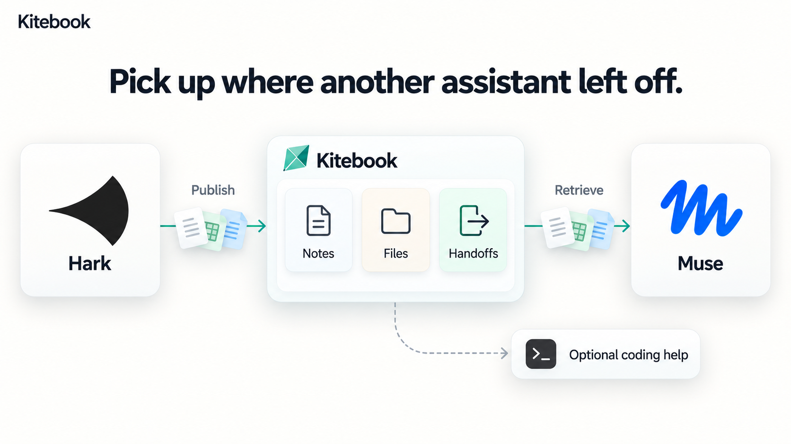

> [!WARNING]
> **Kitebook v0.0.1 is an early preview with a bunch of known bugs.** Expect things to break, and don't point it at anything you can't afford to lose. Please report bugs in [Issues](https://github.com/um1b/kitebook/issues). Known problems are listed in the [CHANGELOG](CHANGELOG.md#known-issues).

# Kitebook

**Pick up your work from any daily assistant. Shared knowledge, files and handoffs across platforms, with published work recoverable after sandbox resets.**

   

For one person whose daily work is scattered across assistants like Hark and Muse:

1. **Continue across assistants.** Publish selected notes, decisions, source files and handoffs in one workspace you own. Another assistant can retrieve them and continue without you rebuilding the context. Kitebook does not automatically observe every conversation; assistants use its tools to share work.
2. **Recover published work after a sandbox reset.** Pull the original files and latest handoff into a fresh environment. Credentials need the platform's persistent integration or secret storage; unpublished sandbox edits cannot be recovered.
3. **Bring in coding agents when needed.** Optionally ask Pi, Codex or Claude Code on your Mac for repository work, with your permissions controlling execution. Results include a branch, diff, test results and summary.

- **You choose each app's access.** Coding tasks ask for approval unless you explicitly save permission to run within chosen limits.
- **Assistants never get a shell.** Your computer connects out, so no ports open.
- **Open and self-hosted.** One small server (your Mac or a Cloudflare Worker), MIT licensed.

<sub>\* Dots: untested / unverified. "Assistants" below always means these personal assistants; the agents on your Mac are "coding agents".</sub>

## Quick start
1. **Install.** On your Mac (or Linux), open Terminal and paste:
   ```bash
   curl -fsSL https://raw.githubusercontent.com/um1b/kitebook/main/scripts/get.sh | bash
   ```
   Windows (PowerShell): `irm https://raw.githubusercontent.com/um1b/kitebook/main/scripts/get.ps1 | iex`. It starts Kitebook, finds the coding agents you already have and opens Kitebook in your browser, signed in.
2. **Give your daily assistant the URL.** In **Settings → Connection**, press **Turn on public access**, then **Copy connection request** and paste it into Hark, Muse or another assistant. It reads the setup instructions and starts pairing where its platform supports it; you open its approval link and choose access. For clients with a custom MCP connector field, use the `/mcp` link instead. If the provider rejects the hostname, follow the [domain guide](docs/domain.md).
3. **Share context.** Ask an assistant to save a project note in Kitebook, then have another assistant read it. For files and datasets that must survive a sandbox restart, use [workspace pull/publish](docs/workspace-sync.md). Coding tasks are optional: ask for a change, approve it when prompted, and get a branch and summary back.

Every step in detail: [docs/quickstart.md](docs/quickstart.md). The installer uses a source checkout; prebuilt binaries and Homebrew packages are planned, with availability tracked in [releases](docs/releases.md). This page follows its current branch; the installer follows stable `main`, so features on `dev` arrive there after promotion.

## How to use

- **Share a decision:** ask your assistant to save a project note in Kitebook, then ask another assistant to retrieve it with its source.
- **Switch assistants:** ask the current assistant to publish the original files and a handoff: goal, completed work, next step and open questions. Ask the next assistant to read that handoff and recover the linked files before continuing.
- **Correct something:** update the existing decision or note so the next assistant can retrieve the current version, rather than adding a contradictory memory.
- **Resume after a reset:** load the persistent connection, verify access, then recover the project's published files and handoff. A stored checkpoint without its local files needs a fresh snapshot.

The [usage walkthrough](docs/how-to-use.md) includes requests to paste into your assistants, a two-assistant sharing check, restart recovery, and optional coding help. Start with a small, non-sensitive project.

## How it works



Daily agents can exchange files, datasets and handoffs without GitHub, then recover published work after a sandbox restart. See [Restart-safe workspaces](docs/workspace-sync.md).

Connected assistants can retrieve the knowledge and files their permissions allow. Published context is available to the others when they next read or synchronize it. For optional coding work, your Mac's runner connects out and hands authorized tasks to a coding agent in a separate git worktree.


One task's life: an assistant asks, Kitebook attaches what it already knows, your runner checks your permission, and then an agent runs. The result, a short summary and anything the agent learned are written back into the knowledge base, so the next assistant or agent starts from there. More detail, including trust boundaries and what never leaves your Mac: [docs/architecture.md](docs/architecture.md).

## Who it's for, and why
For one person who uses several daily assistants for ongoing work. Research, files and decisions can end up scattered across platforms, making it harder to resume. Kitebook gives those assistants one workspace for selected context and recoverable handoffs. Coding agents can use that context too, when needed.

You choose which assistants connect and what they can read or change. The shared workspace is independent of their disposable sandboxes and does not require GitHub for context sharing.

## Supported assistants and agents
| Personal assistants (read memory, send tasks) | Status |
|---|---|
| Grok bot | Supported |
| Hark | Supported, used daily by the maintainer |
| Muse | Supported (MCP or an app key) |
| Dots | Untested / unverified |

Any other MCP client can connect too, with `https://<your-kitebook>/mcp`.

| Coding agents (do the work) | Status |
|---|---|
| Pi, Codex, Claude Code | Used daily by the maintainer |
| Gemini CLI, Cursor, GitHub Copilot CLI, opencode, Grok CLI | Supported, less tested |
| Aider, Cline, others | Not supported yet; tracked in the maintainer backlog |

Runs on macOS (main target), Linux and Windows 10/11. Per OS: [docs/setup.md](docs/setup.md#linux-and-windows).

## Safety, in short
- **Inside an approved task, the agent runs in its own auto mode** in a separate worktree. Your approval is the gate, so read what you approve.
- **The guard is not a sandbox.** It blocks common mistakes (`sudo`, force pushes, deploys, payments) but a determined agent can get past it. A real OS sandbox is on the roadmap.
- **An approval covers one exact task** and expires after 5 minutes. Signed tasks prove which app sent them.
- **The server never runs code**, never holds your agents' secrets and never gives an assistant a shell.

Full model: [docs/security.md](docs/security.md). Report problems privately: [SECURITY.md](SECURITY.md).

## Self-host
Kitebook is one server you own. Pick one:
- **Your Mac** (default): the one-line install runs the server and runner together. Public access is off until you enable it; the built-in quick tunnel uses a temporary address.
- **Cloudflare Workers**: [four commands](docs/setup.md#deploy-to-cloudflare), then connect your Mac from `/start`.
- **workerd / Docker on any box**: run `scripts/serve.sh` from source, or build the server image locally. A published image is not part of the current install path ([storage](docs/storage.md), [build instructions](docs/releases.md#docker-build-from-source)).
- **Local try-out** (cloud assistants can't reach it): `./scripts/quickstart.sh`.

## Public access and stable addresses

| Option | What to expect |
|---|---|
| Built-in Cloudflare quick tunnel | No domain or account needed to try it. Its URL changes on restart, and it does not support SSE. |
| Cloudflare named tunnel with your domain | A stable address for daily use. Configure the token and hostname in Settings → Connection. |
| Tailscale Funnel | Public HTTPS on `ts.net`; an assistant may still reject that hostname. Private Tailscale Serve requires tailnet access. |
| ngrok | An assigned development domain; the free plan has request/data quotas and an HTML browser warning page. |

Use the local address for coding agents on the same computer. A remote assistant needs reachable HTTPS and must accept the hostname; you may need your own domain if its provider blocks shared tunnel addresses. Hark's `ts.net` rejection is owner-reported, while Muse's acceptance remains unverified. See [connection compatibility](docs/setup.md#address-compatibility-and-avoiding-a-domain) for evidence, limits and diagnostics, plus the providers' [Quick Tunnel](https://developers.cloudflare.com/tunnel/get-started/quick-tunnels/) and [ngrok](https://ngrok.com/docs/pricing-limits/free-plan-limits) documentation.

## Develop and test
```bash
git clone https://github.com/um1b/kitebook && cd kitebook
npm install && echo ADMIN_TOKEN=dev-admin-token > .dev.vars
bun run typecheck      # zero errors
npm run test:fast      # unit tests + core end-to-end checks, about 2 min
./smoke.sh             # the full end-to-end suite, about 15 min
```
Code map and conventions: [CONTRIBUTING.md](CONTRIBUTING.md). Pull requests target `dev`.

## Contributing
**Please discuss changes before starting implementation or opening a PR.** Open issues are maintainer backlog items, not an invitation to implement them. Get agreement on the problem and scope in the issue first, and check for an existing PR. Bug reports with reproduction steps are welcome.

Read the [contribution guide](CONTRIBUTING.md) for scope, testing, AI-assisted contributions and review expectations. Accepted code PRs target `dev`. Questions go in [Discussions](https://github.com/um1b/kitebook/discussions). Please follow the [Code of Conduct](CODE_OF_CONDUCT.md).

## Learn more
| Doc | What's in it |
|---|---|
| [docs/architecture.md](docs/architecture.md) | Components, trust boundaries, what never leaves your Mac |
| [docs/quickstart.md](docs/quickstart.md) | The quick start step by step |
| [docs/features.md](docs/features.md) | Everything Kitebook does: tasks, chains, quick asks, shared memory, presence |
| [docs/setup.md](docs/setup.md) | Deploying, accounts, invites, OAuth and connectors |
| [docs/runner.md](docs/runner.md) | The runner: install, approvals, signed tasks, agents and models |
| [docs/git.md](docs/git.md) | Branches, commits, diffs and pull requests |
| [docs/agents.md](docs/agents.md) | For agents: endpoints, MCP tools, the op list |
| [docs/security.md](docs/security.md) | The security model |
| [docs/releases.md](docs/releases.md) | Current install options, planned packages, local Docker builds |
| [docs/storage.md](docs/storage.md) | Where data lives, self-hosting, cost |
| [docs/glossary.md](docs/glossary.md) | Words used on screen |

> **Kitebook was called Relay** until October 2026. Old installs update to the new name by themselves; `relay` still works as a command, and `RELAY_*` environment variables are still read as `KITEBOOK_*`.

## License
[MIT](LICENSE). Provided "as is", without warranty: you run it on your own machine and you are responsible for reviewing what agents change. See [NOTICE](NOTICE) for third-party code.
